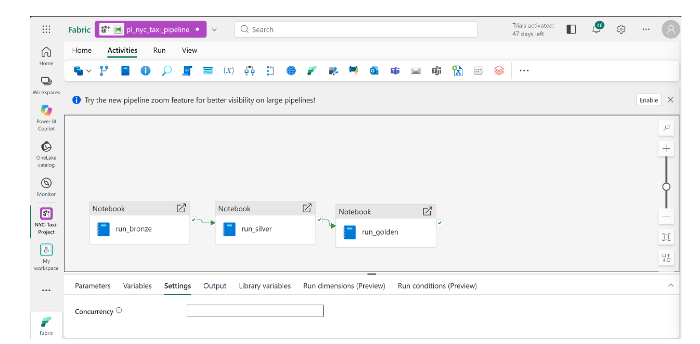

#  NYC High-Volume For-Hire Vehicle (HVFHV) Data Pipeline

An end-to-end cloud-native data engineering solution built within **Microsoft Fabric** and backed by **Azure Data Lake Storage Gen2 (ADLS Gen2)**, processing over **62 million transportation records** using the **Medallion Architecture (Bronze, Silver, Gold)** powered by Delta Lake.

---

## 🏗️ Architecture & Data Flow

The pipeline enforces strict security governance, automated data quality checks, high-concurrency Spark orchestration, real-time monitoring via Data Activator (Reflex), and executive reporting via Power BI.

📄 **[View Full Architecture & Implementation Report (PDF)](report%20-%20Fabric.pdf)**
